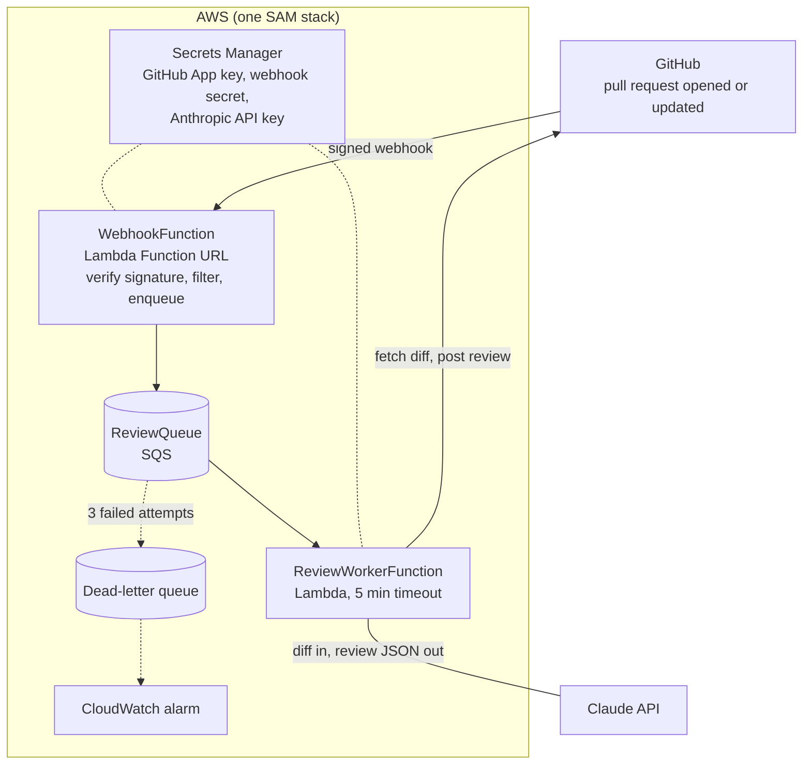

# review-bot



A basic AI code reviewer for GitHub pull requests, running on AWS Lambda and using Claude.
The webhook only checks the signature and queues a job, so it answers GitHub in under a second.
The worker does the slow part: fetch the diff, ask Claude for a review, post it on the PR.

## Prerequisites

- AWS account, [AWS CLI](https://docs.aws.amazon.com/cli/latest/userguide/getting-started-install.html) configured (`aws configure`)
- [AWS SAM CLI](https://docs.aws.amazon.com/serverless-application-model/latest/developerguide/install-sam-cli.html)
- Node.js 22+, `jq`
- An Anthropic API key from https://console.anthropic.com

## 1. Deploy the infrastructure

```bash
npm install
npm run typecheck
sam build
sam deploy --guided   # first time: pick a stack name and region, accept the defaults
```

Note the `WebhookUrl` and `SecretArn` outputs. Later deploys are just `sam build && sam deploy`.

To get emailed when reviews fail (land in the dead-letter queue), set the optional `AlarmEmail` parameter:

```bash
sam deploy --parameter-overrides AlarmEmail=you@example.com
```

AWS then sends a "Subscription Confirmation" email; click its link or nothing is delivered. The alarm emails
on ALARM and again when it returns to OK (after the DLQ is drained). Leave `AlarmEmail` empty for no email;
the `AlarmTopicArn` output is the SNS topic if you'd rather subscribe something else. Later plain
`sam deploy` runs keep the previous value; pass `AlarmEmail=""` to remove the subscription.

`sam deploy --guided` will warn that WebhookFunction has no authorization. That's expected:
GitHub's webhook signature is the authentication, and the function rejects anything unsigned.

## 2. Create the GitHub App

GitHub → Settings → Developer settings → GitHub Apps → **New GitHub App**
(or under your organization's settings for an org-owned app).

| Setting | Value |
|---|---|
| Webhook URL | the `WebhookUrl` output |
| Webhook secret | generate one: `openssl rand -hex 32` (save it) |
| Repository permissions → Pull requests | **Read and write** |
| Repository permissions → Contents | **Read-only** |
| Repository permissions → Metadata | Read-only (default) |
| Subscribe to events | **Pull request**, **Pull request review comment** |
| Where can this app be installed? | Only on this account |

After creating it, note the **App ID**, then click **Generate a private key** (downloads a `.pem`).

## 3. Store the credentials

```bash
SECRET_ARN="<SecretArn output>"

jq -n \
  --arg appId "<App ID>" \
  --arg key "$(cat path/to/your-app.private-key.pem)" \
  --arg webhook "<webhook secret>" \
  --arg anthropic "<Anthropic API key>" \
  '{githubAppId: $appId, githubPrivateKey: $key, githubWebhookSecret: $webhook, anthropicApiKey: $anthropic}' \
| aws secretsmanager put-secret-value --secret-id "$SECRET_ARN" --secret-string file:///dev/stdin
```

Then delete the local `.pem` or move it somewhere safe. If you change the secret later, new values are
picked up when Lambda starts fresh containers; to force it immediately, redeploy or update any env var.

## 4. Install and test

1. On the app's page, **Install App** → choose a test repository.
2. In the app's **Advanced** tab, the first delivery should be a `ping` with a 200 response.
3. Open a PR with a small deliberate bug. Within a minute or so the bot should post a review.

## Debugging

```bash
sam logs -n WebhookFunction --stack-name <stack> --tail
sam logs -n ReviewWorkerFunction --stack-name <stack> --tail
```

- **Nothing happens:** check the app's Advanced tab → Recent Deliveries. 401 means the webhook secret
  doesn't match; 5xx means check the webhook logs.
- **Queued but no review:** check the worker logs. Most common causes are a malformed private key in the
  secret or missing app permissions (you must re-accept the installation after changing permissions).
- **Failures in the DLQ:** read them with `aws sqs receive-message --queue-url <DeadLetterQueueUrl>`,
  fix the cause, then redrive them from the SQS console.

## Per-repo guidance

Sentinel reads review instructions from the repository's **default branch**: the first of
`.sentinel/REVIEW.md`, `REVIEW.md` or `CLAUDE.md` that exists (up to 8,000 characters). Use it for
conventions, things not worth flagging, and areas that need extra care. It is read from the default
branch, never the PR, so a pull request can't change the rules it is reviewed under.

## Replying to a comment

Reply in the thread of any Sentinel comment and it re-reads the code (at the PR's current head) and the
thread, then answers with one of **Standing by this**, **Revised** or **Retracted**. A retraction also
marks the original comment as retracted. It answers the PR author and repo owners, members and
collaborators, never bots, and at most 3 times per thread.

## Configuration

| What | Where |
|---|---|
| Model | `AnthropicModel` stack parameter |
| Failure alert email | `AlarmEmail` stack parameter (confirm the SNS email) |
| Review instructions | `SYSTEM_PROMPT` in `src/lib/reviewer.ts`, plus each repo's guidance file |
| Reply instructions | `SYSTEM_PROMPT` in `src/lib/replier.ts` |
| Replies per thread | `MAX_BOT_REPLIES_PER_THREAD` in `src/lib/threads.ts` |
| Ignored files | `IGNORED_PATH_PATTERNS` in `src/lib/diff.ts` |
| Max diff size | `MAX_DIFF_CHARS` in `src/lib/diff.ts` |
| Max inline comments | `MAX_INLINE_COMMENTS` in `src/lib/github.ts` |
| Parallel reviews | `MaximumConcurrency` in `template.yaml` |

## Tear down

```bash
sam delete --stack-name <stack>
```

Then delete the GitHub App from its settings page.
